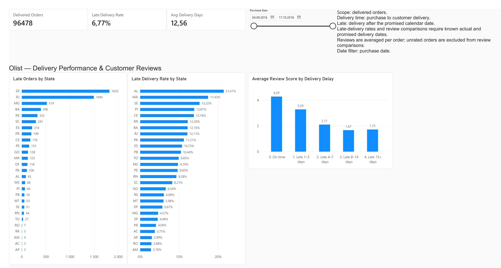

# Olist Delivery Performance & Customer Reviews

**PostgreSQL · SQL · Power BI · DAX**

An analysis of delivery delays in the Brazilian E-Commerce Public Dataset by Olist. The project separates **late-delivery risk** from **the number of affected orders**, then compares customer ratings across delay lengths.

## Business questions

1. How often are delivered orders late, and how long does delivery take?
2. Which customer states have the highest late-delivery rates and volumes?
3. How do order ratings differ across delivery-delay groups?

## Results

These results describe the full dataset, with date and state selections cleared.

| Metric | Result | Population |
|---|---:|---|
| Delivered orders | 96,478 | Orders with status `delivered` |
| Deliveries eligible for timeliness analysis | 96,470 | Delivered orders with actual and estimated delivery dates |
| Late deliveries | 6,534 | Eligible orders delivered after the promised calendar date |
| Late-delivery rate | 6.77% | 6,534 / 96,470 |
| Mean purchase-to-delivery time | 12.56 days | Delivered orders with purchase and actual delivery timestamps |
| Median purchase-to-delivery time | 10 days 05:13:10 | Same duration population |
| 90th percentile delivery time | 23 days 02:18:47 | Same duration population |

### Findings

- **SP and RJ account for 50.7% of late deliveries:** 1,820 and 1,495 orders, respectively. These states are useful starting points for investigating the largest volume of late orders.
- **High volume and high rate identify different priorities.** SP has the most late orders but a 4.49% late rate. AL has a 21.41% late rate on 397 eligible deliveries. Volume and sample size should accompany percentage rankings.
- **Late deliveries have lower average ratings:** 2.27 versus 4.29 for on-time deliveries. This is an observed association; the analysis does not establish a causal effect.

| Delivery-delay group | Rated orders | Mean order rating |
|---|---:|---:|
| On time or early | 89,443 | 4.29 |
| 1–3 days late | 1,852 | 3.29 |
| 4–7 days late | 1,748 | 2.11 |
| 8–14 days late | 1,446 | 1.67 |
| 15+ days late | 1,335 | 1.73 |

The final two groups have similar averages, with a small increase in the 15+ group. Ratings do not decrease strictly at every delay step.

## Dashboard



Preview exported from Power BI and cropped to the report content. The saved PBIX retains its original page size.

Open [the Power BI report](powerbi/olist_delivery_dashboard.pbix) in Power BI Desktop to explore its saved imported data. The purchase-date slicer and state selections update the report.

The dashboard contains three KPI cards, state rankings by late rate and late volume, and ratings by delay group. Tooltips show the relevant order counts. The report's detailed source formulas are documented in [dax/](dax/).

## Data and model

Source: [Brazilian E-Commerce Public Dataset by Olist on Kaggle](https://www.kaggle.com/datasets/olistbr/brazilian-ecommerce).

Only three source CSVs are needed for this analysis: orders, customers and order reviews. Download instructions and attribution are in [data/README.md](data/README.md). Raw CSV files are excluded from version control. The PBIX includes an imported snapshot derived from this dataset.

```text
orders ── customer_id ──> customers
   │
   └── order_id ──> review_scores (one row per order)
                          ↑
                    reviews, aggregated

orders_enriched = all orders + customer_state + mean order_score
```

`orders_enriched` preserves one row per order. Multiple reviews are averaged before joining, so orders with several reviews do not receive extra weight in rating comparisons.

## Reproduce the analysis

### 1. Prepare PostgreSQL

Create a database named `olist_analytics`. Connect to it in pgAdmin and run [sql/00_schema.sql](sql/00_schema.sql).

Download the three CSVs into `data/raw/`. Import each into its matching table using pgAdmin: CSV, UTF-8, header enabled, comma delimiter. The column order matches the original source files. If your database already contains these tables and the imported data, skip schema creation and importing.

Alternatively, from the repository root, use `psql`:

```powershell
psql -h localhost -U postgres -d olist_analytics -v ON_ERROR_STOP=1 -f sql/00_schema.sql
psql -h localhost -U postgres -d olist_analytics -v ON_ERROR_STOP=1 -f sql/01_import_psql.sql
```

`01_import_psql.sql` is for psql, not pgAdmin Query Tool. It refuses to import into nonempty source tables.

### 2. Build the views and run SQL

Run these files in order in pgAdmin Query Tool, or pass each to `psql` with the same connection options:

1. [02_views.sql](sql/02_views.sql) — aggregate reviews and build the order-level view.
2. [03_data_quality.sql](sql/03_data_quality.sql) — inspect keys, join cardinality, missing dates and rating coverage.
3. [04_delivery_metrics.sql](sql/04_delivery_metrics.sql) — delivery duration, timeliness and lateness.
4. [05_state_analysis.sql](sql/05_state_analysis.sql) — late rates and volumes by customer state.
5. [06_review_analysis.sql](sql/06_review_analysis.sql) — ratings and low-score shares by delay group.

Compare the results with [docs/expected_results.csv](docs/expected_results.csv).

### 3. Refresh or rebuild Power BI

The saved report uses an imported PostgreSQL view. To refresh on another computer, configure its PostgreSQL source in Power BI data-source settings to point to your server and `olist_analytics` database, and enter your own database credentials.

To rebuild from scratch, import `public.orders_enriched`, name the Power BI table `public orders_enriched`, then add the columns and measures from [dax/calculated_columns.dax](dax/calculated_columns.dax) and [dax/measures.dax](dax/measures.dax). Each formula is a separate Power BI object; these files are not batch scripts. Visual field mappings and formats are in [docs/methodology.md](docs/methodology.md).

## Data-quality decisions and limitations

- Eight delivered orders lack an actual customer-delivery date. They remain in the delivered-order count and are excluded from calculations requiring that date.
- The reviews table has 99,224 rows for 98,673 order IDs. Its 551 extra rows are additional reviews, not automatically erroneous duplicates. Averaging within each order is the chosen analytical policy.
- Ratings comparisons include 95,824 eligible orders with a score; 646 otherwise eligible deliveries have no score. Review availability may introduce selection bias.
- Small state samples make percentage rankings less stable. Use tooltip counts when interpreting the results.
- State refers to the customer's destination state. Seller location, carrier, distance, product mix and other factors were not controlled for.
- This is a historical dataset. Results are conditional on recorded delivered orders; recent purchase cohorts may be incomplete at the dataset cutoff.

For definitions and validation scope, see [methodology](docs/methodology.md) and [validation](docs/validation.md).

## Repository contents

```text
sql/        Table definitions, import instructions, views and analysis queries
dax/        Calculated columns and measures used in the report
powerbi/    Saved Power BI report
docs/       Definitions, expected results and validation record
data/       Source and download instructions; raw CSVs are ignored
```
